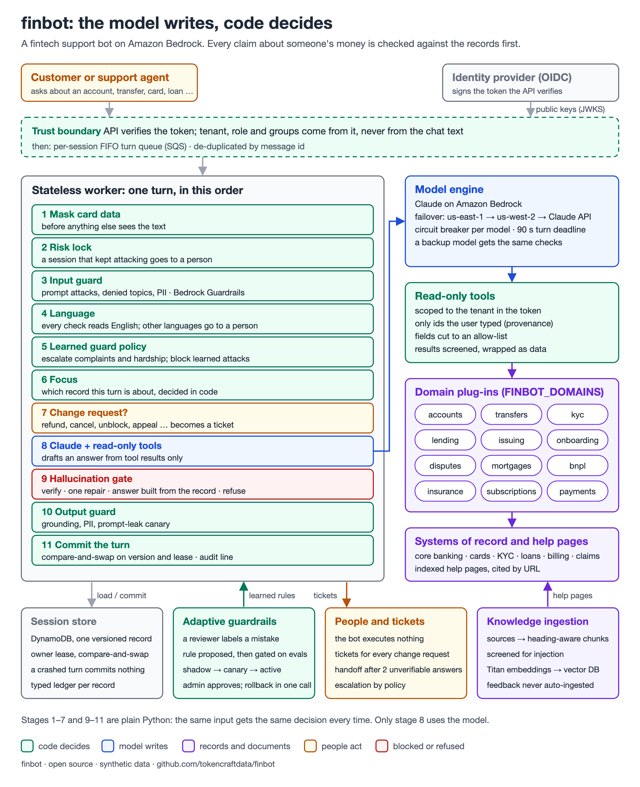
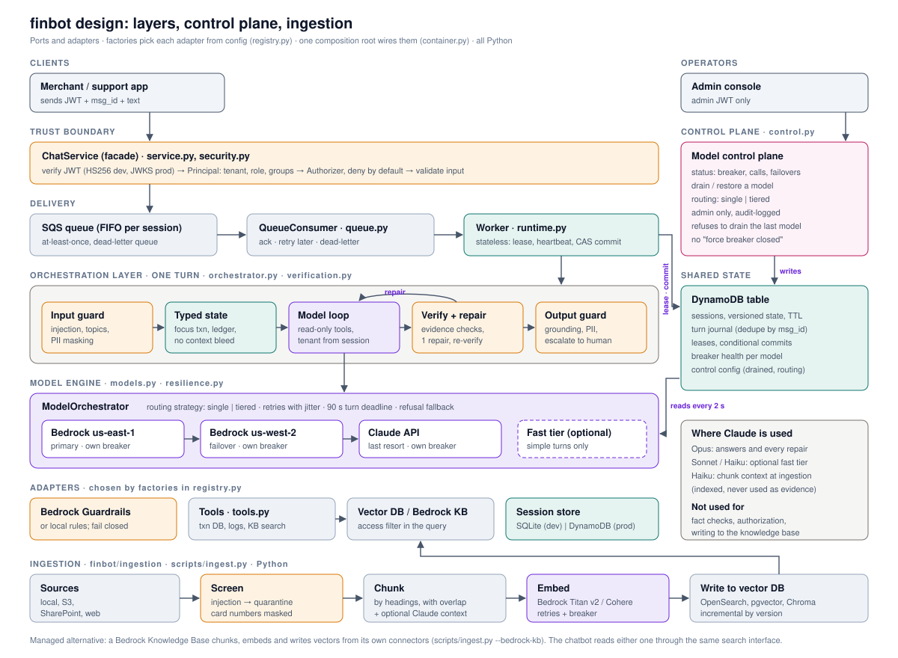

# finbot: a fintech support chatbot that isn't allowed to guess

finbot is an open-source reference implementation of a fintech support chatbot on **Amazon Bedrock** (Claude, Bedrock Guardrails). Claude writes the answer; code decides what it is allowed to claim. It runs on synthetic data and has no connection to any company.

It covers the areas a fintech's support desk actually gets asked about, each as a **domain plug-in** (`finbot/domains/`): bank **accounts** (balances, holds, fees, restrictions), **money movement** (batch, real-time and wire transfers, with irrevocability decided per rail), **issued cards** (status, controls, authorization declines), **KYC / identity verification**, **lending** (applications and servicing), **onboarding**, **disputes and chargebacks**, **mortgage servicing**, **buy now, pay later**, **insurance claims** and **subscription billing** — plus card-payment **acceptance** (declines, retries, processor routing) as one more plug-in that a deployment can switch off (`FINBOT_DOMAINS`). A domain is one module: an id prefix, a read-only fetch tool, an allow-list of fields the model may see, a status vocabulary, a reason-code-to-policy table, and a summary built by code from the record. The core never changes.

It is built around three ideas:

| | What it does | Evidence (offline, scripted model, synthetic data) |
|---|---|---|
| **Hallucination gate** | Every amount, currency, percentage, code, status, date, card detail, record id and link in an answer is checked against this turn's tool results before anyone sees it. One guided repair, then an answer built by code from the record, and only then an honest "I won't guess". Reasons given in plain words are checked against the recorded code. Retry and processor-cascade advice must match policy tables in code | 2,259 hallucinations of 12 kinds injected on purpose, none reached the user; 0 of 3,774 on two fresh held-out sets; 0 of 2,876 correct answers falsely blocked |
| **Adaptive guardrails** | Guardrails improve from reviewer-labelled mistakes, never from raw chat and without retraining. Each proposed rule must fix its own evidence, match no fair question and break no case in the eval and red-team suites, then runs in shadow and a canary before an admin promotes it. Built-in guards are never changed automatically | Escalation to a person, a check on promises the bot can't keep, and a session risk score in the baseline; gate replays 18 guard cases, 41 + 185 eval cases and 35 red-team cases per proposal |
| **Resilience** | Stateless workers, sessions as versioned records with leases, turns saved only when complete, de-duplicated messages, a model failover chain with a circuit breaker per model, a 90-second turn deadline, fail-closed guardrails | Tests crash a worker at each point of a turn, take the session over, and reject the late worker's write; failover mid-turn keeps the same checks; in the routing simulator a two-hour processor outage moves approval from 80.4% to 80.5% |

Underneath all three: prompt-injection defences. Against a stand-in model that obeys any instruction it sees, 0 of 34 attacks succeed with guardrails on, 25 of 34 without.

Read more: [hallucination control](docs/reliability.md#3-hallucination-control), [adaptive guardrails](docs/design.md#10-adaptive-guardrails), [crash recovery and failover](docs/reliability.md#2-crash-recovery-finbotruntimepy), [the article](docs/posts/article.md).



How to add a domain, which other areas the design fits (airline refunds, healthcare claims, returns, SaaS billing) and where it does not (advice, prose rules, discretionary decisions): [docs/domains.md](docs/domains.md). Diagrams for articles, as SVG and 2x PNG: [docs/diagrams/](docs/diagrams/).

## Common mistakes and what finbot does instead

| Common mistake | Problem | finbot |
|---|---|---|
| Docs split on word count | Chunks split mid-sentence and mid-table; no context; no way to cite | Chunks follow headings with overlap; each chunk keeps the section path, page id, version and URL (`knowledge.py`) |
| Pure vector search, or weak embeddings | Weak recall on paraphrases; error codes ("05") are missed in pure-vector search | Hybrid search: BM25 for exact terms plus optional Bedrock Titan embeddings, merged by rank fusion. A minimum score means "no match" is reported instead of padding with weak chunks |
| No guardrails; a lookup returns nothing and the LLM fills the gap | Hallucinated facts about accounts, transfers, payments or loans | Tool replies carry `status: not_found` as a normal answer. The prompt rules plus a **deterministic evidence guard** block any amount, currency, percentage, date, card detail, code or record id not present in this turn's tool data, and any claim about a record that wasn't found |
| Answers anything, falling back to the model's own knowledge | Off-topic risk; confident wrong answers on policy | Bedrock denied topics (investment, legal/tax, off-topic). Knowledge questions must cite the KB or say "no documentation", and code checks that they do. Investment, legal and tax advice is also blocked in answers |
| The bot explains a decision it can't see the reason for | Tipping off: "your account is under review for sanctions screening" | The reason for a review is **not in the domain's field allow-list**, so it never reaches the model. The policy table's answer is "we can't share details of a review", and a guessed cause (a screening hit, a credit score) is blocked as an unsupported reason |
| An undecided case described as decided | "Your application was approved" while underwriting is still open | Every domain carries its status vocabulary, and a status the record doesn't have — in any tense for decisions, in the present tense for transient states — is blocked (`finbot/domains/checks.py`) |
| One long chat; record A leaks into the question about B | Context corruption | Each record (a transfer, a loan, a payment) gets its own **typed ledger**. Code detects a new record id or a general question and switches focus. Other records are marked inactive in a system message. State is rebuilt from the ledger every turn and never held by the LLM |
| Long chats degrade | Drift, cost | History is append-only (keeps the prompt cache working). After 30 turns a fresh thread starts, seeded with the typed state rather than a lossy summary |
| Rated answers fed back into the vector DB automatically | **Memory poisoning**: one bad answer becomes a permanent "source" | Feedback goes to a human review queue. Approved fixes are made in the source docs and flow back through normal, versioned ingestion |
| Long-lived cloud access keys | Leaked keys get reused; no rotation | boto3 default chain (IAM role, SSO, STS); no key is read from code or files. Production sign-in uses the identity provider's public keys (JWKS), so there is no shared secret to store. finbot has no database password; if you add a store that needs one, take it from Secrets Manager |
| The model chooses which tenant to query | Cross-customer data leak through prompt injection | The tenant comes from the auth session. Tool schemas are `strict` with no `tenant_id` field. Tools re-check ownership |
| No per-turn audit trail | Failures can't be diagnosed | One structured audit record per turn (masked text, tools, statuses, guard reasons, latency) |

## Known drawbacks, and what finbot does about each

A strict, checked bot has costs. These are the ones I know of, what the code now does about each, and what is still open.

| Drawback | What finbot does | Still open |
|---|---|---|
| The checker reads numbers, codes and statuses, not a wrong reason in plain words | `finbot/reasons.py`: each decline code and gateway error maps to one cause, and an answer that states a different cause ("code 05 because the card expired") is blocked | It is a phrase table. A cause worded in a way the table doesn't know gets through to the grounding check |
| Being strict means more refusals and handoffs | `finbot/recordanswer.py`: when the model's answer can't be verified, code states what the record shows (status, amount, code, policy next step) instead of refusing. With a faulty scripted model and repair switched off, refusals fell from 39.9% to 8.9% of turns | Help-page questions have no record to fall back on, so they still end in "I won't guess" |
| A repair costs a second model call | `FINBOT_REPAIR_ATTEMPTS=0` skips it: a failed draft goes straight to the record-built answer (2.0 model calls per turn instead of 2.9 in the same run). `scripts/ops_report.py` reports repair, refusal and handoff rates, calls per turn and latency from the audit log | The record-built answer is plainer than a repaired one |
| Rules and reviewer labelling need upkeep | `guard_controller.py upkeep`: hits per rule, learned rules that never fire, proposals waiting on a person, labels per 1,000 turns | A person still has to do the reviewing |
| Only as good as the records and help pages | `scripts/kb_audit.py` fails an ingestion run when a help page is past its age limit or disagrees with the retry and code tables. An answer citing an old page gets a "may be out of date" note added by code | A page that is wrong in a way the tables don't cover is still repeated |
| English only | A message in another language goes to a person with a reply in that language (Spanish, French, German, Portuguese), and a non-English answer is blocked, because every check reads English | It hands over; it doesn't answer in other languages |
| Read-only | Unchanged, on purpose: requests to change something become tickets a person carries out | |
| Unproven on live traffic | The eval, stress test and red team run against Bedrock with one environment variable, and `ops_report.py` reads a live audit log | Not run yet: it needs an AWS account and a model budget |

```bash
python3 scripts/ops_report.py --demo
```

```bash
python3 scripts/kb_audit.py
```

## Layout

```
finbot/ports.py          contracts (Protocols) every layer depends on: LLM, guardrail, store, queue, KB
finbot/registry.py       factories: provider name from config -> adapter (LLM, guardrail, store, embedder, routing)
finbot/container.py      composition root: builds and wires every component; tests pass overrides
finbot/service.py        trust boundary facade: token -> Principal -> authorize -> validate -> worker
finbot/security.py       JWT verification (HS256 dev, JWKS/OIDC prod), deny-by-default Authorizer
finbot/control.py        control plane: drain/restore models, routing mode, audited, shared by all workers
finbot/verification.py   hallucination gate: verifier chain, one bounded repair, record-built answer
finbot/reasons.py        plain-word reasons checked against the recorded decline code or gateway error
finbot/recordanswer.py   the answer code builds from the record when the model's can't be verified
finbot/language.py       language detection: non-English messages go to a person, non-English answers are blocked
finbot/freshness.py      stale help pages, and help pages that disagree with the retry and code tables
finbot/opsmetrics.py     repair, record-answer, refusal and handoff rates from the turn audit log
finbot/untrusted.py      prompt-injection defences: normalise + screen, tool-result sanitising, spotlighting, leak canary
finbot/provenance.py     value provenance: third-party text in tool results cannot vouch for a stated fact
finbot/tenancy.py        request tenant scope; session data only through per-tenant credentials (IAM LeadingKeys)
finbot/cache.py          cache port (memory, Redis/Valkey): help-page searches and breaker health only, never records
finbot/telemetry.py      AI observability: OpenTelemetry GenAI spans, no prompts, answers or record data
finbot/queue.py          queue worker (SQS / in-memory): ack, retry-later, dead-letter
finbot/worker_main.py    queue worker process for a container: one turn at a time, clean SIGTERM, heartbeat
finbot/actions.py        write-request detection: refund/cancel/retry/... asked of a read-only bot
finbot/tickets.py        tickets for people to execute write requests; TicketDesk to claim and resolve
finbot/store_dynamo.py   DynamoDB session store (same contract as store.py), single-table design
finbot/ingestion/        sources (local, S3, SharePoint, web) -> chunk (+Claude context)
                         -> Bedrock embeddings -> vector DB (local, OpenSearch, pgvector, Chroma) | Bedrock KB
finbot/config.py         env settings (provider, model, guardrail id, KB path)
finbot/llm.py            Claude on Bedrock (AnthropicBedrockMantle) | Claude API / gateway | FakeLLM
finbot/models.py         model orchestrator engine: failover chain, breaker per model, refusal fallback, routing
finbot/guardrails.py     Bedrock ApplyGuardrail, local fallback, deterministic evidence guard
finbot/tools.py          typed read-only tools: payment DB, log search, KB, domain records (tenant-scoped)
finbot/domains/          domain plug-ins: accounts, transfers (ach/rtp/wire), kyc, lending, issuing,
                         onboarding, disputes, mortgages, bnpl, insurance, subscriptions — each one module
                         with fields, statuses, policy table and summary; checks.py verifies status,
                         cause and reason keys for all of them (guide: docs/domains.md)
finbot/memory.py         per-entity ledger, focus switching, typed state rendering
finbot/knowledge.py      heading-aware chunks, hybrid BM25 + Titan search
finbot/orchestrator.py   turn pipeline as ordered stages (risk lock, input guard, language, learned policy, focus,
                         write request, model + hallucination gate), append-only history, audit
finbot/pii.py            card data and secrets: detection and masking, used on every path
finbot/replies.py        every fixed reply (decided by code, not written by the model)
finbot/auditlog.py       audit lines to a file or stdout, one "stream" field per source
finbot/store.py          durable session store: versioned state, leases, turn and action journals, TTL
finbot/runtime.py        stateless workers: claim, load, dedupe, run, commit; takeover recovery
finbot/faults.py         fault injection: crashing worker, hallucinating model
finbot/policy.py         card-payment retry rules and role-based next steps (example policy)
finbot/resilience.py     backoff with jitter, circuit breakers, transient-error classification
finbot/processors/       processor orchestration: dialect adapters, routing rule chain, cascade policy,
                         PaymentOrchestrator engine, seeded simulator, read-side views for the bot
finbot/adaptive/         adaptive guardrails: versioned GuardPolicy (escalation, commitment, learned input rules),
                         session risk score, reviewer labels, proposers, regression gate, controller
                         (shadow, canary, approve, rollback)
finbot/evalkit.py        eval scoring shared by run_eval.py and the gate
finbot/redteam.py        red-team harness shared by run_redteam.py and the gate
infra/create_guardrail.py   creates the Bedrock guardrail (topics, PII, prompt attack, grounding)
Dockerfile, deploy/k8s/   worker image and reference EKS manifests (workers, API, ingestion, network policy)
scripts/ingest.py        any source -> any vector store, incremental; or start a Bedrock KB sync
scripts/generate_synthetic.py seeded synthetic customers, payments, domain records, logs, KB pages, eval set
scripts/run_eval.py      runs data/eval.jsonl through the bot with deterministic checks
scripts/run_redteam.py   prompt-injection red team (data/redteam.jsonl) with a worst-case model and ablations
scripts/load_test.py     load test of the full worker path; --model-latency stands in for a real model
scripts/simulate_routing.py  routing scenarios (steady, processor outage, degradation, issuer outage)
scripts/guard_controller.py  adaptive guardrail controller: label, cycle, status, approve, promote, rollback, demo
data/                    synthetic dev split (600 payments + 176 domain records, 41-case eval) +
                         data/test/ held-out split (400 payments + 176 domain records, 185-case eval,
                         21 planted attacks); routing traces on every payment; see data/README.md
docs/diagrams/           article diagrams: make.py draws SVG, export.sh renders 2x PNG
docs/domains.md          domains: what ships, how to add one, where the design fits and doesn't
docs/paper.md            the design and its evaluation written up as a paper, including value provenance
docs/reliability.md      crash recovery, session store, hallucination control
docs/design.svg          design diagram: layers, control plane, ingestion
docs/security.md         prompt injection, red-team results, other controls, research references
docs/design.md           layers, design patterns, control plane, DynamoDB, security, ingestion, where Claude is used
docs/platform-design.md  agent orchestration platform (Kafka, worker pools, leases, cancellation) and
                         multi-tenant AI platform (isolation, quotas, noisy neighbors, leakage)
docs/technical-design.md components, interfaces, data model, verification, resiliency, caching, AI observability,
                         capacity and load, compliance mapping, deployment, open issues
tests/test_finbot.py     17 offline tests, one per failure mode
tests/test_reliability.py  12 tests: crash points, takeover, dedupe, hallucination repair
tests/test_retry_routing.py 20 tests: retry policy, retry guard, backoff, outages, fail-closed, escalation
tests/test_model_engine.py  16 tests: breaker states, failover (incl. mid-turn), refusals, routing, config
tests/test_boundaries.py    9 tests: engine x guardrails, crash during failover, shared breakers, lease heartbeat, turn deadline
tests/test_store_contract.py 20 tests: the same store contract on SQLite and DynamoDB (condition semantics)
tests/test_layers.py        18 tests: factories, JWT/authorization, service boundary, control plane, gate, queue
tests/test_dataset.py       7 tests: splits regenerate byte-identical, are disjoint, test eval passes; refund/date checks
tests/test_injection.py     19 tests: screening, spotlighting, KB screening, URL/credential/leak checks, red-team suite
tests/test_ingestion.py     14 tests: sources, quarantine, incremental sync, PII masking, access filter, Claude context
tests/test_processors.py    33 tests: adapters, routing rules, cascade policy, engine + breakers, simulator,
                            routing tools, routing evidence checks, generated traces
tests/test_adaptive.py      27 tests: rule safety, baseline vs guard cases, escalation, commitment repair, risk lock,
                            canary/shadow, proposers, Claude drafts, gate, controller lifecycle and authorization
tests/test_deployment.py    5 tests: queue worker under rollout, kill and redelivery; FIFO dead-letter
tests/test_operations.py    9 tests: context budget, session-store limits, tickets shared across workers
tests/test_pci.py           13 tests: card data masked on every path (history, audit, tickets, review queue)
tests/test_research.py      8 tests: argument provenance, multi-turn attacks, code-built recap, pass^k
tests/test_provenance.py    12 tests: third-party text cannot vouch for an amount, date, phone or email
tests/test_tenancy.py   17 tests: tenant-first ids, tenant-bound encryption, scoped data access, shared rate limits
tests/test_cancellation.py  6 tests: cancel before start or mid-turn, resend after cancel, owner only, HTTP
tests/test_cache_telemetry.py  14 tests: what is cached, cache outages, records never cached, GenAI spans hold no content
tests/test_tickets.py       14 tests: write requests become tickets; desk claim and resolve
tests/test_mitigations.py   27 tests: plain-word reasons, record-built answers, language, source freshness,
                            upkeep and cost reports, stated details, citations
tests/test_domains.py       27 tests: hidden fields stripped, status/cause/reason-key checks, tickets on
                            domain records, tenant isolation, provenance, record-built summaries, FINBOT_DOMAINS
tests/test_platform_security.py  34 tests: encryption at rest and key rotation, token revocation, agent
                            delegation grants, rate limits, DLP, audit chain, HTTP adapter, SQL/log/header
                            injection, https-only ingestion
tests/test_infra.py          6 tests: ALB TLS and hardening, WAF rules, KMS rotation, write-once audit
                            bucket (needs aws-cdk-lib)
```

405 tests in all.

## Design

Ports and adapters with factories, strategies and one composition root; a control plane
for model orchestration; DynamoDB session store; queue workers; JWT security; multi-source
ingestion into a vector DB. See [docs/design.md](docs/design.md).



## Adaptive guardrails

Guardrails improve from reviewed mistakes, not from raw chat and not by training the model.
A reviewer labels a mistake; the controller proposes a rule, gates it against the eval sets and
the red team, runs it in shadow on live traffic, and an admin promotes it through a canary. It
never touches the built-in guards, loosening needs an admin, and rollback is one call. New
guards in the baseline: escalation to a person (complaints, unauthorised payments, hardship),
a check on promises the bot can't keep, and a session risk score for multi-turn jailbreaks;
the same escalation and promise rules read every domain's answers.
See [docs/design.md](docs/design.md#10-adaptive-guardrails).

## Deployment

Access, the worker cluster, routing, Kubernetes and crash recovery mid-turn are in
[docs/design.md, section 11](docs/design.md). Reference manifests are in
[deploy/k8s/](deploy/k8s/README.md); they have not been applied to a live cluster.

## Security

Prompt injection is handled two ways: reduce what reaches the model (input screening,
tool-result screening, spotlighting), and limit what a successful injection can do (read-only,
tenant-scoped tools, evidence checks, KB-only links, no credential requests, leak canary).
Red team against a model that obeys anything: 0 of 34 attacks succeed defended, 25 of 34
undefended, with no loss on benign look-alikes; 0 of 5 multi-turn escalations succeed defended.
Consistency (pass^k, tau-bench): every eval case passes all k runs with half the answers corrupted. See [docs/security.md](docs/security.md),
which also maps each defence to the research it follows, including the author's
MemoryKeeper study.

Platform controls ([docs/security.md, section 5](docs/security.md)):

- **Agent identity:** a per-turn delegation grant (user, agent, tenant, session, read-only scopes, 5 minutes) is checked before every tool call.
- **Encryption at rest:** AES-256-GCM envelope encryption with KMS, bound to session and purpose.
- **Tokens:** key rotation by `kid`; revocation shared by every pod.
- **Rate limits:** per user and per tenant.
- **DLP:** a PCI and PII scan on every request and response.
- **Audit:** a hash-chained audit log.
- **HTTP adapter:** a hardened adapter (`finbot/http_api.py`).
- **Edge:** the ALB, WAF and KMS stack in Python CDK (`infra/cdk`), not yet deployed.
- **CI scanning:** CodeQL, Bandit, pip-audit, gitleaks and Trivy.

```bash
python3 scripts/run_redteam.py -v
python3 scripts/run_redteam.py --cases data/redteam_multiturn.jsonl -v
python3 scripts/run_consistency.py --k 8
```

## Reliability

Read [docs/reliability.md](docs/reliability.md) for the full picture. In short:

- **Session store:** each session is a durable, versioned case record (ledger, focus, history) with a TTL. Workers are stateless, so any worker can serve any session.
- **Crash recovery:** a lease plus a compare-and-swap commit. A crash mid-turn commits nothing, and the replacement re-runs the turn. A resent message is answered from the journal without calling the model again. A late writer is rejected. An external action whose outcome was never recorded is reconciled with the system of record before anything is retried.
- **Hallucination:** a deterministic evidence guard checks amounts, currencies, percentages, dates, card details, codes, ids, status polarity, unknown outcomes, lifecycle claims, URLs and help-page citations. It gives one verifier-guided repair attempt, then states what the record shows, and only then falls back to "I won't guess", with Bedrock contextual grounding on top. A cause given in plain words must match the recorded code, and answers must be in English. Answers that promise outcomes the bot can't grant ("you'll get a refund", "guaranteed") get the same repair. The stress test injects 342 hallucinations of 12 kinds on the dev split and 1,807 on the held-out split, and none leak; correct answers produce no false blocks (count in docs/reliability.md). Domain records get the same treatment: a wrong status (in any tense for decisions), a cause the record doesn't carry, a guessed review reason or an unseen reason key is blocked.
- **Payment retries and routing:** retry rules and next steps are computed in code per decline code or gateway error, and worded for the asker's role. A guard blocks retry advice that breaks the policy (hard declines, "retry now" on soft declines, any definite claim on a timeout).
- **Model orchestrator engine:** every model call goes through an ordered failover chain (for example Bedrock us-east-1, then us-west-2, then the Claude API). Each model has its own circuit breaker (closed, open, half-open probe), refusals fall back to the next model, failover works mid-turn, and optional routing sends simple turns to a faster model. Run `/status` in the CLI to see each model's breaker state and failovers. Breaker state is shared through the session store, so a replacement worker after a crash skips a model another worker already found down. Guards run around the engine, so a backup model's answer gets the same checks. See [how the layers fit together](docs/reliability.md#7-how-the-layers-compose-guardrail-boundary-crash-recovery-resilience).
- **System retries:** one backoff layer with circuit breakers for each model and each backend. Guardrail failures fail closed. Outages roll the turn back so a resend works. After two unverifiable answers in a row the user is directed to a human, with a reference.

```bash
python3 scripts/run_eval.py --hallucinate
```

## Synthetic data

`data/` is ready to use: 8 customers, 600 card payments (373 approved, 94 declined, 127 failed, 6 unknown after a timeout), 176 domain records (16 accounts, 56 transfers across ach/rtp/wire, 16 KYC cases, 16 loans and applications, 16 issued cards, 8 onboarding applications, 16 disputes, 8 mortgages, 8 buy-now-pay-later plans, 8 insurance claims, 8 subscriptions), 2,993 log events, 21 wiki-style help pages and 41 labelled eval cases. Every payment carries a routing trace across three simulated processors. The app loads it automatically. Regenerate it, or make a bigger set:

```bash
python3 scripts/generate_synthetic.py --out data --seed 7 --txns 600
```

The same seed gives byte-identical files; `data/MANIFEST.json` records the counts and hashes.

For measuring, use the held-out test split in `data/test/`. It has 8 different customers, 400
new payments plus its own domain records, statement descriptors with 21 planted attacks and 10
benign look-alikes, and a 185-case templated eval:

```bash
python3 scripts/generate_synthetic.py --split test
python3 scripts/run_eval.py --data data/test
```

Generate a fresh seed whenever you want an unbiased number after changing the bot (see `data/README.md`).

## Run

Offline (no AWS, scripted model):

```bash
python3 -m unittest discover -s tests -v
```

```bash
python3 scripts/run_eval.py
```

```bash
python3 -m finbot.app
```

```bash
python3 scripts/simulate_routing.py
```

```bash
python3 scripts/guard_controller.py demo
```

Code hygiene (ruff and mypy settings are in `pyproject.toml`; `finbot/processors/` and `finbot/adaptive/` are type-checked strictly):

```bash
python3 -m venv .venv && .venv/bin/pip install ruff mypy
```

```bash
.venv/bin/ruff check . && .venv/bin/mypy finbot
```

The offline eval only checks that the pipeline is wired correctly. The scripted model is built to behave well, so passing offline says nothing about Claude. Run the same eval with `FINBOT_LLM_PROVIDER=bedrock` to measure the real model.

On AWS:

```bash
pip install -r requirements.txt
```

```bash
python3 infra/create_guardrail.py --region us-east-1
```

```bash
FINBOT_LLM_PROVIDER=bedrock FINBOT_GUARDRAIL=bedrock FINBOT_GUARDRAIL_ID=<id> FINBOT_GUARDRAIL_VERSION=1 FINBOT_EMBEDDINGS=titan python3 -m finbot.app
```

Through the Claude API or an internal gateway instead of Bedrock: `FINBOT_LLM_PROVIDER=anthropic` (set `ANTHROPIC_BASE_URL` for a gateway). The default model is `claude-opus-5-5` (`anthropic.claude-opus-5-5` on Bedrock). Set `FINBOT_MODEL=claude-sonnet-5-5` for lower cost. Bedrock Guardrails work with either provider because ApplyGuardrail is a standalone call.

Replace `InMemoryTxns` / `InMemoryLogs` in `app.py` with adapters for your transaction database and log store, or for your MCP servers. The interface is two methods.

## Enhancements, in priority order

1. **Eval set before anything else.** Take 200 real, masked support questions and label the expected tool calls and answers. Score groundedness, not-found handling, topic-switch bleed and refusal rate. Run it on every prompt or model change.
2. **Reranker.** Bedrock Cohere Rerank on the top 20 hybrid hits brings large precision gains on documentation questions.
3. **Managed retrieval.** Move the JSON index to OpenSearch Serverless or Bedrock Knowledge Bases, keeping the chunker and metadata. For wiki sources, use the managed connectors of Bedrock Managed Knowledge Base (incremental sync, inclusion/exclusion filters) rather than custom crawlers.
4. **Answer templates for the top intents** (decline explanation, refund status, chargeback stage, settlement timing). Facts are filled from tools and the LLM only phrases them, so more of each answer can be checked.
5. **Citations shown in the UI.** Show users the source URL and the "as of" timestamp for transaction facts.
6. **Escalation path.** A low-confidence or guard-blocked turn opens a ticket with the typed state attached, so support doesn't start from zero.
7. **Cost and latency.** Prompt caching is already on for the system prompt and tools. Use lower effort for simple lookups and a smaller model for intent routing.
8. **Security tests in CI.** Prompt-injection inputs (including text planted inside help pages and log messages), cross-tenant IDs, and PII round-trips.
9. **Write actions later, behind confirmation.** Refunds and retries go through a workflow API with a human-in-the-loop step, and the bot reports success only after a real receipt.
10. **Per-region data residency.** Pin the Bedrock region or inference profile to where card data is allowed to be processed (PCI DSS scope review).
