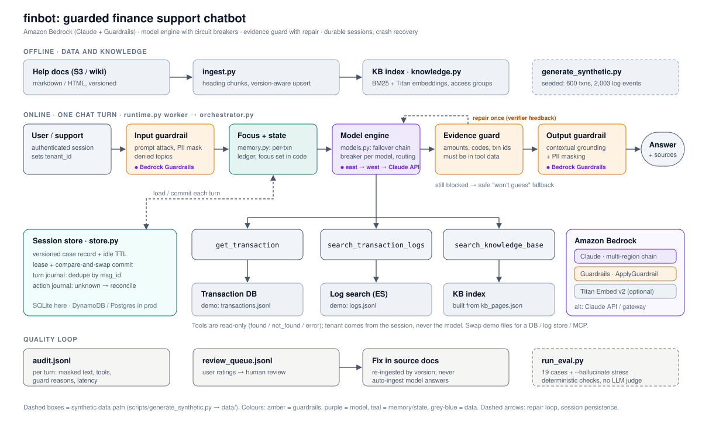

# finbot: a guarded finance support chatbot

A general-purpose chatbot for finance and payments support. It runs on **Amazon Bedrock** (Claude), uses **Bedrock Guardrails**, and can switch to the **Claude API or an internal LLM gateway**. It is a personal reference project on synthetic data. It avoids the mistakes that keep showing up in finance chatbots and applies the findings of my MemoryKeeper study on agent memory.



## Common mistakes and what finbot does instead

| Common mistake | Problem | finbot |
|---|---|---|
| Docs split on word count | Chunks split mid-sentence and mid-table; no context; no way to cite | Chunks follow headings with overlap; each chunk keeps the section path, page id, version and URL (`knowledge.py`) |
| Pure vector search, or weak embeddings | Weak recall on paraphrases; error codes ("05") are missed in pure-vector search | Hybrid search: BM25 for exact terms plus optional Bedrock Titan embeddings, merged by rank fusion. A minimum score means "no match" is reported instead of padding with weak chunks |
| No guardrails; a lookup returns nothing and the LLM fills the gap | Hallucinated transaction facts | Tool replies carry `status: not_found` as a normal answer. The prompt rules plus a **deterministic evidence guard** block any amount, code or txn id not present in this turn's tool data, and any claim about a transaction that wasn't found |
| Answers anything, falling back to the model's own knowledge | Off-topic risk; confident wrong answers on policy | Bedrock denied topics (investment, legal/tax, off-topic). Knowledge questions must cite the KB or say "no documentation" |
| One long chat; transaction A leaks into the question about B | Context corruption | Each transaction gets its own **typed ledger**. Code detects a new txn id or a general question and switches focus. Other transactions are marked inactive in a system message. State is rebuilt from the ledger every turn and never held by the LLM |
| Long chats degrade | Drift, cost | History is append-only (keeps the prompt cache working). After 30 turns a fresh thread starts, seeded with the typed state rather than a lossy summary |
| Rated answers fed back into the vector DB automatically | **Memory poisoning**: one bad answer becomes a permanent "source" | Feedback goes to a human review queue. Approved fixes are made in the source docs and flow back through normal, versioned ingestion |
| Long-lived cloud access keys | Leaked keys get reused; no rotation | boto3 default chain (IAM role, SSO, STS). DB credentials come from Secrets Manager with rotation |
| The model chooses which tenant to query | Cross-merchant data leak through prompt injection | The tenant comes from the auth session. Tool schemas are `strict` with no `tenant_id` field. Tools re-check ownership |
| No per-turn audit trail | Failures can't be diagnosed | One structured audit record per turn (masked text, tools, statuses, guard reasons, latency) |

## Layout

```
finbot/ports.py          contracts (Protocols) every layer depends on: LLM, guardrail, store, queue, KB
finbot/registry.py       factories: provider name from config -> adapter (LLM, guardrail, store, embedder, routing)
finbot/container.py      composition root: builds and wires every component; tests pass overrides
finbot/service.py        trust boundary facade: token -> Principal -> authorize -> validate -> worker
finbot/security.py       JWT verification (HS256 dev, JWKS/OIDC prod), deny-by-default Authorizer
finbot/control.py        control plane: drain/restore models, routing mode, audited, shared by all workers
finbot/verification.py   hallucination gate: verifier chain + one bounded repair
finbot/untrusted.py      prompt-injection defences: normalise + screen, tool-result sanitising, spotlighting, leak canary
finbot/queue.py          queue worker (SQS / in-memory): ack, retry-later, dead-letter
finbot/worker_main.py    queue worker process for a container: one turn at a time, clean SIGTERM, heartbeat
finbot/actions.py        write-request detection: refund/cancel/retry/... asked of a read-only bot
finbot/tickets.py        tickets for people to execute write requests; TicketDesk to claim and resolve
finbot/store_dynamo.py   DynamoDB session store (same contract as store.py), single-table design
finbot/ingestion/        sources (local, S3, SharePoint, web) -> chunk (+Claude context)
                         -> Bedrock embeddings -> vector DB (local, OpenSearch, pgvector, Chroma) | Bedrock KB
finbot/config.py         env settings (provider, model, guardrail id, KB path)
finbot/llm.py            Claude on Bedrock (AnthropicBedrockMantle) | Claude API / gateway | FakeLLM
finbot/models.py         model orchestrator engine: failover chain, breaker per model, refusal fallback, routing
finbot/guardrails.py     Bedrock ApplyGuardrail, local fallback, deterministic evidence guard
finbot/tools.py          typed read-only tools: transaction DB, log search, KB (tenant-scoped)
finbot/memory.py         per-entity ledger, focus switching, typed state rendering
finbot/knowledge.py      heading-aware chunks, hybrid BM25 + Titan search
finbot/orchestrator.py   turn pipeline, one verifier repair attempt, append-only history, audit, feedback queue
finbot/store.py          durable session store: versioned state, leases, turn and action journals, TTL
finbot/runtime.py        stateless workers: claim, load, dedupe, run, commit; takeover recovery
finbot/faults.py         fault injection: crashing worker, hallucinating model
finbot/policy.py         payment retry rules and role-based next steps (example policy)
finbot/resilience.py     backoff with jitter, circuit breakers, transient-error classification
finbot/processors/       processor orchestration: dialect adapters, routing rule chain, cascade policy,
                         PaymentOrchestrator engine, seeded simulator, read-side views for the bot
finbot/adaptive/         adaptive guardrails: versioned GuardPolicy (escalation, commitment, learned input rules),
                         session risk score, reviewer labels, proposers, regression gate, controller
                         (shadow, canary, approve, rollback)
finbot/evalkit.py        eval scoring shared by run_eval.py and the gate
finbot/redteam.py        red-team harness shared by run_redteam.py and the gate
infra/create_guardrail.py   creates the Bedrock guardrail (topics, PII, prompt attack, grounding)
Dockerfile, deploy/k8s/   worker image and reference EKS manifests (workers, API, ingestion, network policy)
scripts/ingest.py        any source -> any vector store, incremental; or start a Bedrock KB sync
scripts/generate_synthetic.py seeded synthetic merchants, transactions, logs, KB pages, eval set
scripts/run_eval.py      runs data/eval.jsonl through the bot with deterministic checks
scripts/run_redteam.py   prompt-injection red team (data/redteam.jsonl) with a worst-case model and ablations
scripts/simulate_routing.py  routing scenarios (steady, processor outage, degradation, issuer outage)
scripts/guard_controller.py  adaptive guardrail controller: label, cycle, status, approve, promote, rollback, demo
data/                    synthetic dev split (600 txns, 27-case eval) + data/test/ held-out split
                         (400 txns, 170-case eval, 21 planted attacks); routing traces on every
                         transaction; see data/README.md
docs/architecture.svg    the diagram above
docs/reliability.md      crash recovery, session store, hallucination control
docs/design.svg          design diagram: layers, control plane, ingestion
docs/security.md         prompt injection, red-team results, other controls, research references
docs/design.md           layers, design patterns, control plane, DynamoDB, security, ingestion, where Claude is used
tests/test_finbot.py     17 offline tests, one per failure mode
tests/test_reliability.py  12 tests: crash points, takeover, dedupe, hallucination repair
tests/test_retry_routing.py 20 tests: retry policy, retry guard, backoff, outages, fail-closed, escalation
tests/test_model_engine.py  16 tests: breaker states, failover (incl. mid-turn), refusals, routing, config
tests/test_boundaries.py    9 tests: engine x guardrails, crash during failover, shared breakers, lease heartbeat, turn deadline
tests/test_store_contract.py 20 tests: the same store contract on SQLite and DynamoDB (condition semantics)
tests/test_layers.py        18 tests: factories, JWT/authorization, service boundary, control plane, gate, queue
tests/test_dataset.py       7 tests: splits regenerate byte-identical, are disjoint, test eval passes; refund/date checks
tests/test_injection.py     19 tests: screening, spotlighting, KB screening, URL/credential/leak checks, red-team suite
tests/test_ingestion.py     14 tests: sources, quarantine, incremental sync, PII masking, access filter, Claude context
tests/test_processors.py    33 tests: adapters, routing rules, cascade policy, engine + breakers, simulator,
                            routing tools, routing evidence checks, generated traces
tests/test_adaptive.py      27 tests: rule safety, baseline vs guard cases, escalation, commitment repair, risk lock,
                            canary/shadow, proposers, Claude drafts, gate, controller lifecycle and authorization
```

212 tests in all.

## Design

Ports and adapters with factories, strategies and one composition root; a control plane
for model orchestration; DynamoDB session store; queue workers; JWT security; multi-source
ingestion into a vector DB. See [docs/design.md](docs/design.md).


## Adaptive guardrails

Guardrails improve from reviewed mistakes, not from raw chat and not by training the model.
A reviewer labels a mistake; the controller proposes a rule, gates it against the eval sets and
the red team, runs it in shadow on live traffic, and an admin promotes it through a canary. It
never touches the built-in guards, loosening needs an admin, and rollback is one call. New
guards in the baseline: escalation to a person (complaints, unauthorised payments, hardship),
a check on promises the bot can't keep, and a session risk score for multi-turn jailbreaks.
See [docs/design.md](docs/design.md#10-adaptive-guardrails).

## Deployment

Access, the worker cluster, routing, Kubernetes and crash recovery mid-turn are in
[docs/design.md, section 11](docs/design.md). Reference manifests are in
[deploy/k8s/](deploy/k8s/README.md); they have not been applied to a live cluster.

## Security

Prompt injection is handled two ways: reduce what reaches the model (input screening,
tool-result screening, spotlighting), and limit what a successful injection can do (read-only,
tenant-scoped tools, evidence checks, KB-only links, no credential requests, leak canary).
Red team against a model that obeys anything: 0 of 27 attacks succeed defended, 19 of 27
undefended, with no loss on benign look-alikes. See [docs/security.md](docs/security.md),
which also maps each defence to the research it follows, including the author's
MemoryKeeper study.

```bash
python3 scripts/run_redteam.py -v
```

## Reliability

Read [docs/reliability.md](docs/reliability.md) for the full picture. In short:

- **Session store:** each session is a durable, versioned case record (ledger, focus, history) with a TTL. Workers are stateless, so any worker can serve any session.
- **Crash recovery:** a lease plus a compare-and-swap commit. A crash mid-turn commits nothing, and the replacement re-runs the turn. A resent message is answered from the journal without calling the model again. A late writer is rejected. An external action whose outcome was never recorded is reconciled with the system of record before anything is retried.
- **Hallucination:** a deterministic evidence guard checks amounts, codes, ids, status polarity, unknown outcomes, lifecycle claims and URLs. It gives one verifier-guided repair attempt, then falls back to "I won't guess", with Bedrock contextual grounding on top. Answers that promise outcomes the bot can't grant ("you'll get a refund", "guaranteed") get the same repair. The stress test injects 210 hallucinations of 10 kinds on the dev split and 1,392 on the held-out split, and none leak; 448 correct answers produce no false blocks.
- **Payment retries and routing:** retry rules and next steps are computed in code per decline code or gateway error, and worded for the asker's role. A guard blocks retry advice that breaks the policy (hard declines, "retry now" on soft declines, any definite claim on a timeout).
- **Model orchestrator engine:** every model call goes through an ordered failover chain (for example Bedrock us-east-1, then us-west-2, then the Claude API). Each model has its own circuit breaker (closed, open, half-open probe), refusals fall back to the next model, failover works mid-turn, and optional routing sends simple turns to a faster model. Run `/status` in the CLI to see each model's breaker state and failovers. Breaker state is shared through the session store, so a replacement worker after a crash skips a model another worker already found down. Guards run around the engine, so a backup model's answer gets the same checks. See [how the layers fit together](docs/reliability.md#7-how-the-layers-compose-guardrail-boundary-crash-recovery-resilience).
- **System retries:** one backoff layer with circuit breakers for each model and each backend. Guardrail failures fail closed. Outages roll the turn back so a resend works. After two unverifiable answers in a row the user is directed to a human, with a reference.

```bash
python3 scripts/run_eval.py --hallucinate
```

## Synthetic data

`data/` is ready to use: 8 merchants, 600 transactions (373 approved, 94 declined, 127 failed, 6 unknown after a timeout), 2,993 log events, 9 wiki-style help pages and 27 labelled eval cases. Every transaction carries a routing trace across three simulated processors. The app loads it automatically. Regenerate it, or make a bigger set:

```bash
python3 scripts/generate_synthetic.py --out data --seed 7 --txns 600
```

The same seed gives byte-identical files; `data/MANIFEST.json` records the counts and hashes.

For measuring, use the held-out test split in `data/test/`. It has 8 different merchants, 400
new transactions, statement descriptors with 21 planted attacks and 10 benign look-alikes, and a
170-case templated eval:

```bash
python3 scripts/generate_synthetic.py --split test
python3 scripts/run_eval.py --data data/test
```

Generate a fresh seed whenever you want an unbiased number after changing the bot (see `data/README.md`).

## Run

Offline (no AWS, scripted model):

```bash
python3 -m unittest discover -s tests -v
```

```bash
python3 scripts/run_eval.py
```

```bash
python3 -m finbot.app
```

```bash
python3 scripts/simulate_routing.py
```

```bash
python3 scripts/guard_controller.py demo
```

Code hygiene (ruff and mypy settings are in `pyproject.toml`; `finbot/processors/` and `finbot/adaptive/` are type-checked strictly):

```bash
python3 -m venv .venv && .venv/bin/pip install ruff mypy
```

```bash
.venv/bin/ruff check . && .venv/bin/mypy finbot
```

The offline eval only checks that the pipeline is wired correctly. The scripted model is built to behave well, so passing offline says nothing about Claude. Run the same eval with `FINBOT_LLM_PROVIDER=bedrock` to measure the real model.

On AWS:

```bash
pip install -r requirements.txt
```

```bash
python3 infra/create_guardrail.py --region us-east-1
```

```bash
FINBOT_LLM_PROVIDER=bedrock FINBOT_GUARDRAIL=bedrock FINBOT_GUARDRAIL_ID=<id> FINBOT_GUARDRAIL_VERSION=1 FINBOT_EMBEDDINGS=titan python3 -m finbot.app
```

Through the Claude API or an internal gateway instead of Bedrock: `FINBOT_LLM_PROVIDER=anthropic` (set `ANTHROPIC_BASE_URL` for a gateway). The default model is `claude-opus-5-5` (`anthropic.claude-opus-5-5` on Bedrock). Set `FINBOT_MODEL=claude-sonnet-5-5` for lower cost. Bedrock Guardrails work with either provider because ApplyGuardrail is a standalone call.

Replace `InMemoryTxns` / `InMemoryLogs` in `app.py` with adapters for your transaction database and log store, or for your MCP servers. The interface is two methods.

## Enhancements, in priority order

1. **Eval set before anything else.** Take 200 real, masked support questions and label the expected tool calls and answers. Score groundedness, not-found handling, topic-switch bleed and refusal rate. Run it on every prompt or model change.
2. **Reranker.** Bedrock Cohere Rerank on the top 20 hybrid hits brings large precision gains on documentation questions.
3. **Managed retrieval.** Move the JSON index to OpenSearch Serverless or Bedrock Knowledge Bases, keeping the chunker and metadata. For wiki sources, use the managed connectors of Bedrock Managed Knowledge Base (incremental sync, inclusion/exclusion filters) rather than custom crawlers.
4. **Answer templates for the top intents** (decline explanation, refund status, chargeback stage, settlement timing). Facts are filled from tools and the LLM only phrases them, so more of each answer can be checked.
5. **Citations shown in the UI.** Show users the source URL and the "as of" timestamp for transaction facts.
6. **Escalation path.** A low-confidence or guard-blocked turn opens a ticket with the typed state attached, so support doesn't start from zero.
7. **Cost and latency.** Prompt caching is already on for the system prompt and tools. Use lower effort for simple lookups and a smaller model for intent routing.
8. **Security tests in CI.** Prompt-injection inputs (including text planted inside help pages and log messages), cross-tenant IDs, and PII round-trips.
9. **Write actions later, behind confirmation.** Refunds and retries go through a workflow API with a human-in-the-loop step, and the bot reports success only after a real receipt.
10. **Per-region data residency.** Pin the Bedrock region or inference profile to where card data is allowed to be processed (PCI DSS scope review).
