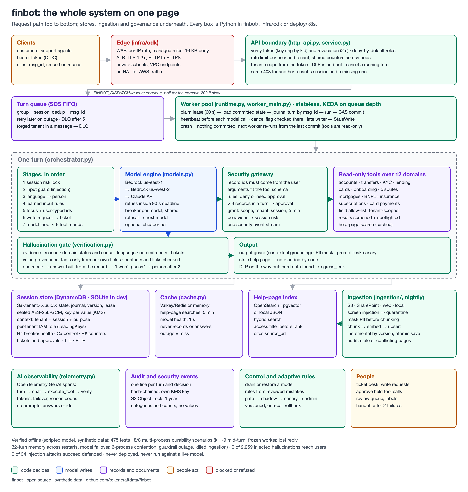

# finbot documentation

Start with the one-page diagram, then read in the order that fits your question.

| If you want to know | Read |
|---|---|
| Which requirements are met, with evidence | [requirements.md](requirements.md) |
| Why it is built this way | [decisions.md](decisions.md) (13 architecture decisions) |
| The layers, patterns and deployment overview | [design.md](design.md) |
| Components, interfaces, data model, resiliency, reconciliation, capacity, compliance | [technical-design.md](technical-design.md) |
| How a release is cut, checked, rolled out and rolled back | [release.md](release.md) |
| Security: injection, red team, PCI, keys, identity | [security.md](security.md), [agent-security.md](agent-security.md) |
| Crash recovery, the session store, hallucination control | [reliability.md](reliability.md) |
| Adding a product area, and where the design does not fit | [domains.md](domains.md) |
| Scaling to many agents and many tenants | [platform-design.md](platform-design.md) |
| The design and its evaluation as a paper | [paper.md](paper.md) |
| What changed in each version | [../CHANGELOG.md](../CHANGELOG.md) |

Diagrams (SVG and 2x PNG, drawn by `diagrams/make.py`): the whole system, the turn pipeline,
the hallucination gate, a domain plug-in, and the security layers.

Everything here describes code that runs offline with a scripted model and synthetic data.
Nothing has been deployed to AWS or run against a live model.
