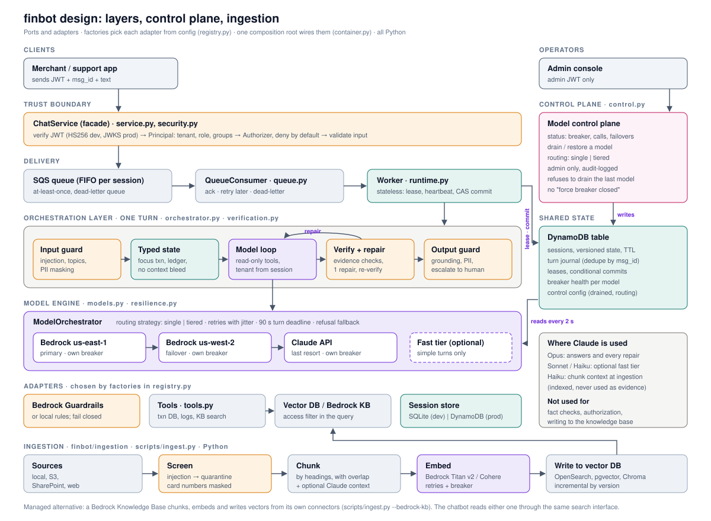

# finbot design: layers, patterns, control plane, ingestion



Everything here is Python. The serving path and the ingestion/data-science path
share one codebase and one set of contracts (`finbot/ports.py`).

## 1. Layers

```
  HTTP / Lambda / CLI
        │  token
  ┌─────▼──────────────────────────────────────────────────────────────┐
  │ service.py       trust boundary (facade)                           │
  │   verify token → Principal → Authorizer → validate input           │
  ├────────────────────────────────────────────────────────────────────┤
  │ queue.py         QueueConsumer (SQS / in-memory): at-least-once,   │
  │                  retry_later on outage, DLQ after max_receives      │
  │ runtime.py       Worker: claim lease → load → journal → ask →      │
  │                  heartbeat → CAS commit                             │
  ├────────────────────────────────────────────────────────────────────┤
  │ orchestrator.py  ORCHESTRATION LAYER (one turn)                    │
  │   input guard → focus/state → model loop → HallucinationGate →     │
  │   output guard → escalation → audit                                │
  │ verification.py  Verifier chain + bounded repair                   │
  │ models.py        model engine: chain, breakers, failover, routing  │
  │ resilience.py    retry_call (jitter, deadline), CircuitBreaker     │
  ├────────────────────────────────────────────────────────────────────┤
  │ control.py       CONTROL PLANE: drain/restore models, routing mode │
  ├────────────────────────────────────────────────────────────────────┤
  │ adapters         llm.py · guardrails.py · tools.py · store.py ·    │
  │                  store_dynamo.py · ingestion/*                      │
  └────────────────────────────────────────────────────────────────────┘
  container.py wires it all (composition root); registry.py holds the factories.
```

Rule: arrows point down only. The orchestration layer never imports boto3,
anthropic, sqlite3 or a vector DB client.

## 2. Patterns and where they live

| Pattern | Where | What it buys |
|---|---|---|
| Ports & adapters | `ports.py`; adapters in `llm.py`, `guardrails.py`, `store*.py`, `ingestion/` | Swap a vendor with config, test offline |
| Factory / registry | `registry.py` (`LLM_PROVIDERS`, `GUARDRAILS`, `STORES`, `EMBEDDERS`, `ROUTING`), `ingestion/__init__.py` (`SOURCES`, `VECTOR_STORES`, `INGEST_EMBEDDERS`) | New provider = one registered function; unknown names fail with the list of known ones |
| Strategy | `RoutingStrategy` (single, tiered), `Verifier`, `Chunker`, embedders, `TokenVerifier` | Change a policy without touching the pipeline |
| Adapter | `ClaudeLLM` (Bedrock and Claude API), `BedrockGuardrail`, `Boto3Dynamo`, `SqsQueue`, `OpenSearchVectorStore`, `PgVectorStore`, `ChromaVectorStore`, `JwksJwtVerifier` | Vendor SDKs stay at the edge |
| Decorator | `ClaudeContextualizer` wraps any chunker; fault injectors (`faults.py`) wrap any LLM | Add behaviour without subclassing |
| Chain of responsibility | `VerifierChain` | Add a hallucination check as one class |
| Template method | `IngestionPipeline.run` | Fixed safe order: screen → chunk → embed → upsert → delete stale |
| Facade | `ChatService` | One entry point owns auth and validation |
| Composition root / DI | `Container` (lazy singletons, `overrides=`) | Tests replace any piece without patching modules |
| Circuit breaker, retry, bulkhead-by-deadline | `resilience.py`, `models.py`, `processors/engine.py` | Fail fast, never hang a user |
| Adapter (processor dialects) | `processors/adapters.py` (`ADAPTERS` registry) | Three response dialects become one canonical code set |
| Strategy + chain (routing rules) | `processors/routing.py` (`RULES` registry, `Router`) | Add or reorder a routing rule without touching the engine |
| Policy object | `processors/cascade.py`, `policy.py` | Money-relevant decisions live in code, not in the model |
| Immutable versioned value | `adaptive/policy.py` (`GuardPolicy`) | Every guard change is a new version; rollback is "make the previous one active" |
| Strategy (proposers, suites) | `adaptive/proposers.py`, `adaptive/gate.py` | Add a way to propose rules, or a regression suite, as one class |
| State machine | `adaptive/controller.py` (proposed → rejected / report / awaiting_approval → shadow → canary → active) | A change can't skip the gate, shadow traffic or an admin |

## 3. Robustness map

| Failure | Handled by | Proven by |
|---|---|---|
| Hallucinated amount, status, code, URL, retry advice | `HallucinationGate`: verify, one repair on the strong tier, re-verify against the repair's own tool results, else fallback | `run_eval.py --hallucinate` (0 of 103 leaked), `test_layers.Gate` |
| Model 429/5xx/timeout | `retry_call` with jitter, per-model breaker, failover to the next target | `test_model_engine`, `test_boundaries` |
| Model refuses | refusal fallback to the next target, output still verified | `test_boundaries.test_refusal_fallback_cannot_bypass_guards` |
| Guardrail service down | fail closed | `test_boundaries` |
| Whole turn too slow | 90 s turn deadline across retries + failover | `test_boundaries.LeaseAndDeadline` |
| Worker crash mid-turn | nothing committed; lease lapses; replacement re-runs from last commit; breaker state shared | `test_store_contract` (both stores), `test_boundaries` |
| Duplicate delivery / client resend | turn journal dedupes by `msg_id` | `test_layers.QueueWorker` |
| Poison message | retried with backoff, then DLQ | `test_layers.QueueWorker` |
| Forged tenant in a queue message | re-checked against the session; DLQ | `test_layers.QueueWorker` |
| Cross-tenant access | tenant from verified token only; tools scope by session tenant | `test_layers.ServiceBoundary`, eval `tenant_isolation` |
| Operator needs to pull a model | control plane drain, applied by every worker within `control_sync_s` | `test_layers.ControlPlaneTests` |

## 4. Control plane (model orchestration)

`ControlPlane` writes, workers read. Config lives in the shared store under
`model_engine`; each engine re-reads it at most every 2 s.

- `status` per target: enabled, breaker state, calls, failovers, refusals, p50.
- `drain(name, reason)` refuses to remove the last enabled strong model.
- `restore(name)` brings a target back; its breaker still has to see a healthy probe.
- `set_routing(single|tiered)` turns the cheaper-model tier on or off. `tiered` needs a fast chain.

Every change needs an `admin` Principal and is audit-logged (who, what, why).
Forcing a breaker closed is deliberately not offered.

## 5. Session store: SQLite → DynamoDB

`STORES.create(FINBOT_STORE_PROVIDER)` picks `sqlite` (one host) or `dynamodb`.
Both pass the same contract test (`tests/test_store_contract.py`). The DynamoDB run
uses `InMemoryDynamo`, which evaluates the real condition expressions.

| Guarantee | DynamoDB primitive |
|---|---|
| one owner per session | conditional Put on owner/lease |
| commit only if nothing changed | `TransactWriteItems`: session META (version, owner, live lease) + turn item |
| dedupe | turn item keyed `T#<msg_id>` |
| idle cleanup | TTL on `expires` (reads also check it) |
| shared breaker health / control config | `H#<model>`, `C#<key>` items |

Table definition: `store_dynamo.TABLE_DEFINITION` (on-demand, KMS, PITR).

## 6. Security

- `Principal` (subject, tenant, role, groups) comes only from a verified JWT.
  - `hmac` (HS256) for dev.
  - `jwks` (Cognito, Okta or Entra ID via PyJWT) for production.
- The verifier checks signature, `alg`, `exp`, `nbf`, `iss` and `aud`.
- The `Authorizer` is deny-by-default:
  - `merchant` and `support` may chat, in their own tenant's sessions only.
  - `admin` may use the control plane only.
- An unknown session and another tenant's session return the same 403, so ids cannot be probed.
- No static AWS keys anywhere. Every boto3 client uses the default credential chain (IAM role).

## 6b. Prompt injection

Covered in [security.md](security.md): what reaches the model is screened and spotlighted, and
a successful injection still can't read other tenants, change state, assert false facts, cite
planted links, request secrets or leak the prompt. Red team: 0/27 defended, 19/27 undefended.

## 7. Ingestion → vector DB (Python)

```
  sources                  screen                 chunk                embed               vector DB
  local / s3 /          →  injection → QUARANTINE  →  heading-aware   →  Bedrock Titan v2  →  local JSON
  sharepoint / web         card numbers → masked     (+ Claude context)  or Cohere (batch)    OpenSearch Serverless
                                                                                              pgvector (Aurora)
                                                                                              Chroma
```

The pipeline is incremental by document version. It upserts the new chunks,
then deletes the stale ones, so a document is never missing from the index.
With `--full-sync` it also removes documents that left the source. A failure
on one document is reported and the run carries on.

There is also a managed path, `BedrockKnowledgeBase`. Bedrock's own connectors
(S3, plus the wiki and SaaS connectors of Bedrock Managed Knowledge Base) do the chunking, embedding and vector writes;
`sync()` starts an ingestion job. Either way, the chatbot reads through the same
`KnowledgeSearch` port, selected with `FINBOT_KB_PROVIDER=index|vector|bedrock_kb`.

Retrieval re-ranks vector candidates by exact query-word coverage, because
embeddings blur codes like "51" and "N7". Weak or partial matches return
`not_found`, so the bot says it has no documentation instead of guessing.

```bash
python scripts/ingest.py --source local:data/kb_pages.json --store local:kb_vectors.json --embed hashing
```

## 8. Where Claude is used, and where it is not

| Use | Model | Why |
|---|---|---|
| Answering (tool loop) | Opus on Bedrock, failover chain | Reasoning over tool results |
| Repair after a failed verification | strong tier, always | The cheap path already failed |
| Simple turns (optional, `tiered`) | Sonnet/Haiku | Cost; off by default |
| Chunk context at ingestion | Haiku, low effort, document prompt-cached | Better recall; offline batch |
| Possible next steps | Claude-as-judge `Verifier` for free-text policy answers; LLM-graded eval cases; drafting fixes for docs from the human review queue | Each is one class behind an existing port |

Claude is **not** used for:

- **Verification of facts.** This stays deterministic, against tool results.
- **Authorization or tenant scoping.** This is code.
- **Writing to the knowledge base.** Model answers never become sources; the review queue fixes the source docs.
- **Evidence.** Claude-written chunk context is indexed but never returned as evidence.

## 9. Processor orchestration

finbot explains how a payment was routed across processors; it never routes one. The
routing code lives in `finbot/processors/` so the synthetic data is produced by the same
rules the bot explains, and so those rules are tested on their own.

```
Payment ─► Router (capability → health → cost → local) ─► candidates
              │
              ▼
        for each candidate:  client.authorize ─► adapter.decode ─► canonical code
                             breaker (per processor)            CascadePolicy.decide
              │                                                    │ allowed → next processor
              ▼                                                    ▼ refused → stop
        RoutingTrace (plan + attempts) stored on the transaction ─► bot tools read it
```

| Module | Job |
|---|---|
| `model.py` | Frozen value types: `Payment`, `Attempt`, `RoutePlan`, `RoutingTrace`, `Outcome` |
| `codes.py` | Canonical codes (ISO 8583 style) and the one definition of processor-side faults |
| `adapters.py` | One adapter per dialect: numeric codes (northstar), refusal strings (meridian), HTTP error objects (keystone) |
| `catalog.py` | Capabilities, fees, local countries, incidents; loaded from `processors.json` |
| `routing.py` | Rule chain; each rule records a step only when it changes the candidate list |
| `cascade.py` | May a failed attempt go to the next processor? |
| `engine.py` | `PaymentOrchestrator`: route, attempt, normalise, decide, record |
| `simulator.py` | Seeded simulated processors, issuer model and scenarios |
| `explain.py` | Read side for the bot: trace plus code-computed `cascade_advice`; tenant-scoped health |

**Design choices**

- **Canonical codes, unmapped never guessed.** Every dialect decodes to one code set. An unknown
  response becomes `UNMAPPED` and is never cascaded or retried. A "closest match" mapping is how
  a hard decline gets retried as a soft one.
- **Cascade only what the issuer never saw.** A processor error (rejected before the card
  network) or issuer-unavailable may move to the next processor, up to 3 attempts. Issuer
  declines never cascade: the same issuer answers on every processor, and each attempt counts
  toward card-network reattempt limits. Timeouts never cascade: the first processor may have
  authorised the payment, so cascading risks a double charge.
- **Breakers per processor, on the orchestrator's clock.** Only processor-side faults count
  against a processor. An issuer decline means the processor worked. An open breaker removes
  the processor in the health rule, and the trace says so ("northstar skipped: circuit open").
- **Rule order is a design decision.** Hard constraints first, health second, then cost, then
  local acquiring (a stable sort keeps the cost order within each locality tier).
- **The bot stays read-only.** `get_routing_trace` and `get_processor_health` read stored data.
  Health stats use only the asking tenant's newest 500 transactions; incidents are platform
  facts every tenant may see.
- **Routing claims are evidence-checked.** Processor names, "it cascaded", "processor X was
  down" and "send it to another processor" must match the trace, the logs or the health record
  (`guardrails.routing_check`).

**Simulator** (`python3 scripts/simulate_routing.py`, 2,000 payments per simulated day):

| Scenario | Approval | Cascaded | Note |
|---|---|---|---|
| steady | 80.4% | 44 | 1% processor error rates |
| northstar_outage (2 h) | 80.5% | 50 | failover absorbs it; the breaker limits northstar to 15 failed calls |
| keystone_degraded | 79.6% | 125 | 10 payments have no other eligible processor |
| issuer_outage | 65.2% | 400 | cascading cannot fix an issuer: more attempts, lower approval |

The example rules (attempt limit, which outcomes cascade) are for the synthetic data. Replace
them with your networks' and acquirers' current rules before production.

## 10. Adaptive guardrails

finbot's guardrails improve from reviewed mistakes without training the model and without
letting chat text rewrite the rules. Code in `finbot/adaptive/`.

```
reviewer labels ──► proposers ──► gate ──► shadow ──► canary ──► active
 (review queue)     (rules +      (own      (logged,   (% of      (all
                     regression    cases,    not        sessions)  sessions)
                     cases)        benign,   enforced)
                                   suites)
       ▲                                                              │
       └───────── turn audit: drift per version, shadow divergence ◄──┘
```

**What the policy holds.** A `GuardPolicy` is a versioned, immutable set of learned rules on top
of the built-in guards:

| Rule kind | Runs on | Effect |
|---|---|---|
| `input_block` | user text (same decoded views as the injection screen) | blocked like a prompt attack |
| `escalate` | user text | the turn goes to a person: complaints, unauthorised payments, stolen cards, hardship, bereavement |
| `commitment` | the answer, as a verifier | promises the bot can't keep ("you'll get a refund", "guaranteed") get one repair, then the fallback |
| `risk_threshold` | session risk score | +2 per blocked attack, +1 for probing language, -0.5 per clean turn; at the threshold the session goes to a person and stays locked |

The baseline ships with escalation and commitment rules and is checked against
`data/guard_cases.jsonl`.

**Rules the controller enforces.**

- **Built-in guards are never changed.** The prompt-attack screen, PII masking, evidence checks,
  retry and cascade policy and tenant scoping are code. A false positive on one of them comes back
  as a `report` for engineering, never as an automatic change. Baseline rules change by code
  review only; the controller can remove only rules it learned.
- **Only a reviewer's label starts a change.** Raw chat text never becomes a rule. A label says
  what went wrong (missed attack, missed escalation, broken promise, or a false block); the
  reviewer may highlight the phrase. Without a highlight, a rule needs wording shared by at least
  two labelled messages. Claude may draft a regex (`ClaudeProposer`), with the examples passed as
  data; the draft is validated and gated like any other.
- **The gate checks three things.** The change fixes its own evidence. A new input rule matches
  none of the benign corpus (fair questions from the eval sets and the benign red-team cases).
  Replaying the guard cases, the dev eval, the held-out eval and the red team, no case that passed
  before fails after (case-level, not just the same score). Rules with nested quantifiers, empty
  matches or more than 200 characters are refused.
- **Tightening reaches shadow automatically; nothing reaches users without an admin.** Shadow runs
  on every turn and is logged with whether it would have decided differently. Loosening needs an
  admin approval with a reason, and is re-gated first.
- **Promotion needs shadow traffic.** `promote` refuses until the shadow policy has seen
  `min_shadow_turns` real turns. Canary uses a stable hash of the session id, so a conversation
  never switches policy midway.
- **Every step is audited and reversible.** Labels, cycles, approvals, promotions and rollbacks are
  logged with who, what and why. Earlier versions are kept, so rollback is one call (canary first,
  then shadow, then the previous active).
- **No weight training.** Prompts, retrieval and rules adapt; model weights do not. If you ever
  fine-tune, use only reviewer-approved examples and run the same gate and rollout.
- **Fail closed.** If the stored state can't be read, workers keep the last good policy, or the
  baseline. Guards never switch off.

**Demo:** `python3 scripts/guard_controller.py demo` labels five mistakes, runs a cycle (three
rules pass the gate on 18/18 guard cases, 27/27 dev, 170/170 held-out, 33/33 red team; one false
block on a built-in guard goes to engineering), runs 120 turns with the shadow policy logged
(one turn diverges, as expected), promotes through a 10% canary and rolls back.
