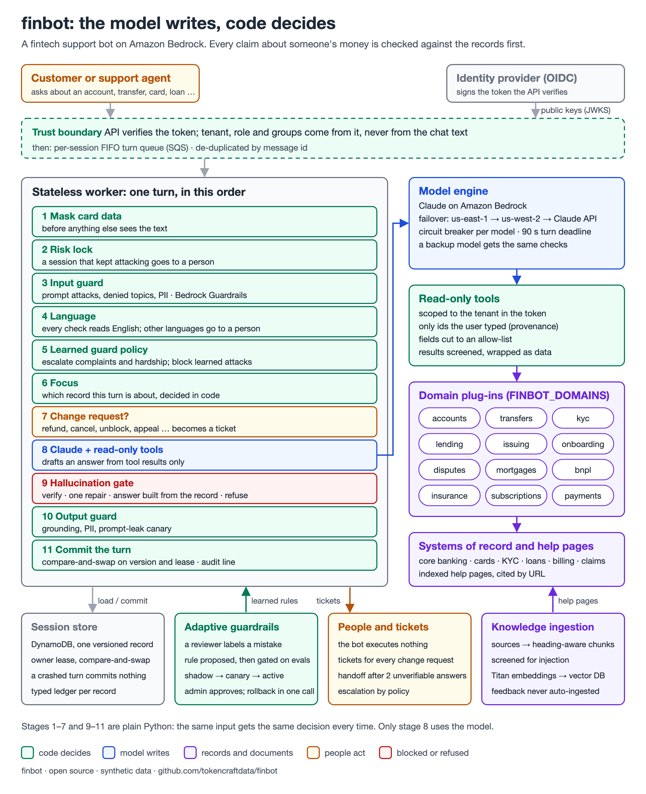
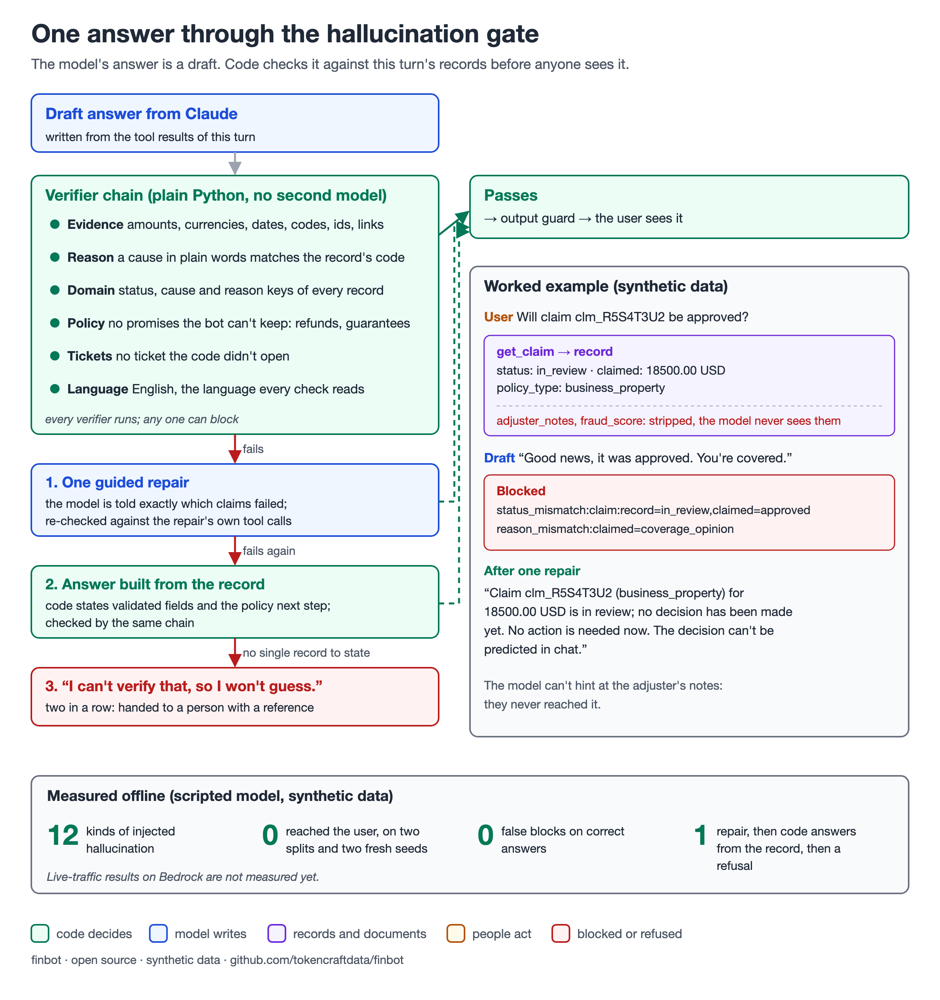
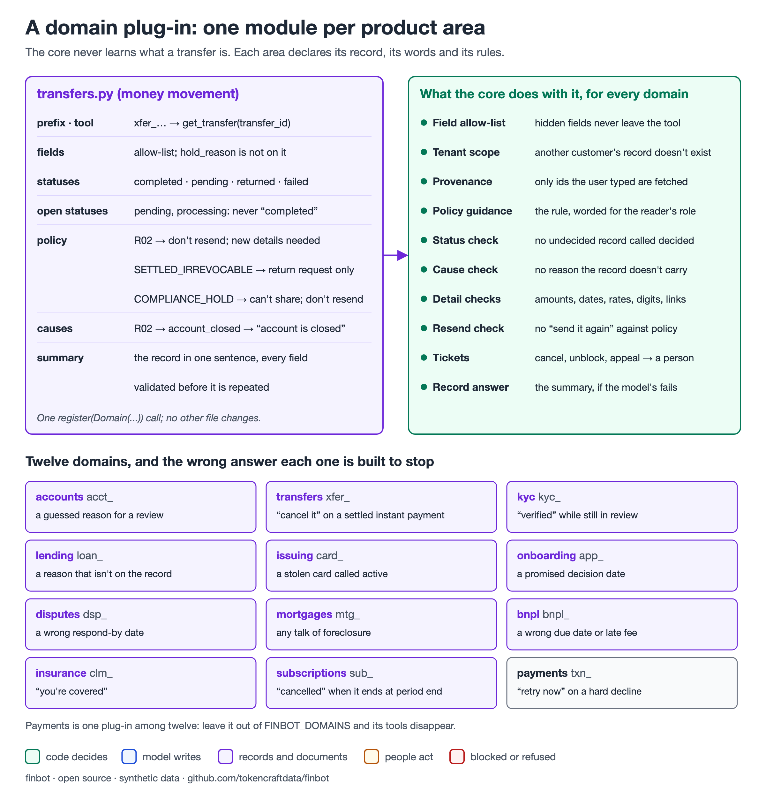

# Nine ways finance chatbots get it wrong, and how I fixed each one

*A fintech support bot that is not allowed to guess: accounts, transfers, cards, payments, KYC, lending and onboarding, and what goes wrong in most finance chatbots. Python, Amazon Bedrock, Claude.*

---

A fintech support bot has one job that matters more than sounding helpful: it must never tell someone something about their money that the records don't back up. That covers more than payments: a balance on hold, a returned transfer, a frozen card, an identity check in review, a loan application, an onboarding decision.

Finance chatbots tend to fail that test in the same few ways. So I built **finbot**, an open reference project, to see whether each failure could be fixed in code rather than with a cleverer prompt. Claude does the language. Code decides what it's allowed to claim. Each product area is a plug-in — one module with the record's fields, statuses, reason codes and policy table — and a deployment switches areas on and off with one setting, card payments included.

*Only stage 8 uses the model.*

It comes down to three ideas: a **hallucination gate** that checks every fact before it's sent, **adaptive guardrails** that improve from reviewed mistakes without retraining anything, and **resilience**, so the bot stays correct when a model or a worker goes down. Here are the problems, and what I did about each.

---

## 1. The bot answers when the lookup returned nothing

**The problem.** The database or log search comes back empty, and the model fills the gap. The customer gets a confident description of a transaction that doesn't exist.

**What I did.** "Not found" is a normal answer, not an error. Every tool returns `found`, `not_found` or `error`, and the prompt says what to do with each. Then a checker, ordinary code and not a second model, reads the draft answer before anyone sees it. If the lookup said `not_found` and the answer describes the payment anyway, it's blocked.

## 2. The answer contains facts the records don't support

**The problem.** The model gets the status backwards, invents a fee, or quotes a link nobody gave it.

**What I did.** Every amount, currency, code, transaction id, link and status in the answer is compared with what the tools returned in that turn. It handles negation, so "was not approved" doesn't count as "was approved". It also refuses definite claims about an outcome the records say is still unknown, such as a timeout.

A failed answer gets one guided rewrite. The model is told exactly which claims didn't check out, and the rewrite is checked again against the tools it called during the repair. If it still fails, the user sees "I can't verify that, so I won't guess." Two of those in a row and the bot hands over to a person with a reference number.

Here's what that looks like for a payment (synthetic data):

> **User:** why did txn_A1B2C3D4 fail?
>
> **Model's draft:** Transaction txn_A1B2C3D4 was approved for 12.34 USD.
>
> **Checker:** blocked. The record says declined, 129.00 USD.
>
> **After one repair:** Transaction txn_A1B2C3D4 was declined for 129.00 USD with decline code 05 (Do not honor). Ask the customer to use another card or call their bank. Don't retry with the same card details.

Why not use another LLM as the judge? The facts that matter here are exact. Comparing strings and numbers against the system of record is cheap, fast and easy to audit.

## 3. Retry advice lives in the prompt

**The problem.** In payments, the most expensive wrong answers are about retries. Retry a hard decline and you annoy the issuer and may pay fees. Retry a timeout and you might charge the customer twice. A prompt that says "be careful with retries" doesn't stop "just retry it".

**What I did.** Retry policy is a table in code. When the bot fetches a transaction, the tool attaches guidance from that table, worded for the person asking. The checker then confirms the answer followed it. "Retry now" on a code 05 decline is blocked, however confident the wording.

## 4. "Just send it through the other processor"

**The problem.** Merchants with more than one processor ask this all the time. A bot will happily say yes. But if the card's bank declined, every processor reaches the same bank and gets the same no. And if the first processor timed out, it may have approved the payment, so trying elsewhere can charge the customer twice.

**What I did.** The cascade rule is in code too. Only failures the bank never saw (a processor error before the card network, or the bank being unreachable) may move to the next processor. Bank declines, timeouts and any response code nobody has mapped never do. The bot reads each payment's routing record, and if an answer names the wrong processor, invents a failover or an outage, or suggests another processor when the rule says it won't help, it's blocked.

A small simulator runs the same rules over a day of 2,000 synthetic payments. A two-hour processor outage barely moves approval (80.4% to 80.5%), because failover and a breaker per processor absorb it. A large card issuer going down costs about 15 points, and sending eight times as many payments to a second processor doesn't help. Whose failure it was decides the answer.

## 5. One long chat history

**The problem.** "Why did this one fail?" "And that one?" A decline code from the first transaction turns up in the answer about the second.

**What I did.** State lives in code, not in the model's memory. Each session keeps a small ledger, one entry per transaction, holding only facts that came from tools. Code decides which transaction is in focus, and the checker rejects amounts or codes that belong to a different one. After 30 turns the conversation moves to a fresh thread seeded with that ledger.

## 6. Rated answers flow back into the knowledge base

**The problem.** A thumbs-up answer gets added to the vector database "to improve the bot". One hallucination becomes a permanent source.

**What I did.** Feedback goes to a human review queue. Fixes are made in the source documents and come back through normal, versioned ingestion. Model output never becomes a source.

## 7. No real guardrails

**The problem.** Prompt injection, investment advice from a payments bot, card numbers echoed back.

**What I did.** Two layers. First, cut down what reaches the model: the user's message is screened after undoing tricks like invisible characters and base64, Bedrock Guardrails runs on top, and text inside transaction records (a merchant name, a customer note) is screened too, because an attacker can write it. Second, make sure an injection that gets through can't do much: tools are read-only and scoped to the logged-in customer from a verified token, links are allowed only if they're a help page's own address, and answers that ask for a card number or password are blocked.

I tested this against a deliberately gullible stand-in model that obeys any instruction it sees, so the score measures the system rather than the model. With every guardrail on, 0 of 34 attacks succeeded. With none, 25 of 34 did. Harmless look-alikes, like a merchant called "System Repair Shop", were answered normally in every setup.

## 8. The bot breaks when something else breaks

**The problem.** A model endpoint throttles, a region has an outage, or the worker serving a conversation dies halfway through a turn. The bot hangs, answers from half-finished work, or answers the same message twice.

**What I did.** Workers keep no state of their own. Each session is a versioned record with an owner lease and a journal of turns, and a turn is saved only when it's complete, with a compare-and-swap on the version and the lease. If a worker dies mid-turn, nothing is saved; another worker picks the session up when the lease lapses and re-runs the message. A late write from the old worker is rejected. Messages are de-duplicated by id, so a resent message gets the stored answer without another model call.

Every model call goes through an ordered failover chain, each model with its own circuit breaker, and a 90-second deadline caps retries and failover together. The backup model's answer goes through exactly the same checks. If a guardrail service is down, the bot fails closed rather than answering unguarded.

## 9. The bot explains a decision it was never allowed to see

**The problem.** An account is frozen for a compliance review, or an application sits with a reviewer, and the bot helpfully speculates: "this is usually a sanctions screening hit". That guess can breach anti-tipping-off rules, and a wrong "your application was approved" is almost as bad.

**What I did.** Two structural rules, not prompt rules. The reason for a review is not in the record's field allow-list, so the model never sees it and cannot repeat it; the policy table's answer is "we can't share details of a review", and a guessed cause (a screening hit, a credit score) is blocked as a reason the records don't carry. And every domain declares its status vocabulary, so an undecided case described as decided — in any tense for decisions — is blocked by the checker.

---

## Where else this works, and where it doesn't

The pattern needs a record, reason codes and a policy table. Inside finance that now covers twelve plug-ins, including disputes, mortgages, buy-now-pay-later, insurance claims and subscription billing. Outside it, airline refunds (the Air Canada case), healthcare claims, returns and SaaS billing have the same shape. It does not fit judgement: advice, interpreting prose rules (the NYC MyCity failure), or decisions a person must make. There the bot refuses or hands over.

---

## Making the guardrails adaptive

**Guardrails that learn, carefully.** Fixed rules go stale. When a reviewer marks a mistake (a missed complaint, a promise the bot shouldn't make), a controller proposes a new rule. The rule only ships if it fixes the labelled cases, matches none of the fair questions in the test sets, and breaks no case in the eval or red-team suites. It then runs in shadow mode on live traffic before an admin promotes it to a share of sessions, and then to everyone. Built-in guards are never changed this way, and loosening a rule always needs a person. No model is retrained.

**Promises are checked too.** A tribunal held Air Canada liable for a refund policy its chatbot invented. finbot blocks answers that promise refunds, reversals or guarantees, and sends complaints, unauthorised payments and hardship to a person, which is also what the US Consumer Financial Protection Bureau has asked of chatbots in consumer finance.

---

## What I tested, and what I haven't

All of this runs offline with a scripted stand-in model and seeded synthetic data covering all twelve areas.

- 315 automated tests pass.
- The eval set passes 41 of 41, and a held-out set 185 of 185.
- I injected 2,259 hallucinations of 12 kinds on purpose, flipped loan and verification decisions included. None reached the user. On two freshly generated test sets, 0 of 3,774.
- 2,876 correct answers, across failed payments and every other kind of record, produced no false blocks.

What this doesn't show: behaviour with live models, real traffic, real latency or real cost. A live evaluation on Bedrock is next, and I'll publish the results whatever they are.

## The drawbacks, and what I did about each

A bot this strict has costs. These are the ones I know of.

- **The checker reads patterns, not meaning.** It caught a wrong amount, code or status, but not a wrong *reason* in plain words. Now each decline code maps to one cause, and an answer that gives a different one ("code 05 because the card expired") is blocked. It's still a phrase table, so an unfamiliar wording gets through.
- **Strict means more handoffs.** "I won't guess" is safe, but it resolves nothing. Now, when the model's answer can't be verified, code states what the record shows: status, amount, code and the next step. With a faulty scripted model and no repair call, refusals fell from 39.9% to 8.9% of turns. Help-page questions have no record to fall back on, so they still end in a refusal.
- **A repair costs a second model call.** It can be switched off: a failed draft goes straight to the record-built answer, at 2.0 model calls per turn instead of 2.9 in the same run. I haven't measured this on live traffic.
- **The rules need upkeep.** A report shows how often each rule fires, which learned rules never fire, and what is waiting on a person. Reviewers still have to keep labelling mistakes.
- **It's only as good as the records.** An audit fails ingestion when a help page is too old or disagrees with the retry and code tables, and an answer that cites an old page gets a "may be out of date" note. A page that is wrong in some other way is still repeated.
- **It can't fix anything, and it reads English only.** Read-only is deliberate: a request to change something becomes a ticket for a person. A message in another language goes to a person, with a reply in that language, instead of being answered unchecked.
- **It's unproven live.** Nothing above changes that.

## If you're building one

- Make "not found" a real answer.
- Check facts in code against the system of record. One repair, then an honest fallback.
- Put policy in tables, not prompts, and check the answer follows them.
- Cascade only what the bank never saw.
- Plan for failure: a breaker per model, a turn deadline, turns saved only when complete.
- Treat retrieved documents, and free text inside your own records, as untrusted input.

finbot is a personal reference project. It runs on synthetic data and has no connection to any company. The code is Python on Amazon Bedrock: [github.com/tokencraftdata/finbot](https://github.com/tokencraftdata/finbot)

If you run payment support in production, I'd like to hear where you think this is wrong.
