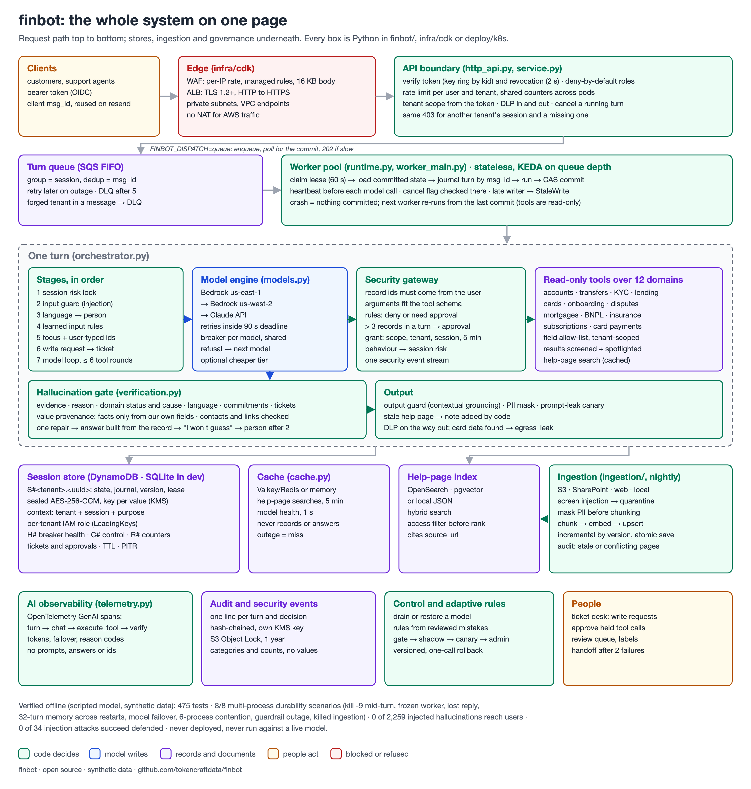

# Requirements: met, partly met, or not

*November 2026.* Every requirement set for finbot, with its status and the evidence: a test, a
script, or a document. "Met" means built and verified **offline** (scripted model, synthetic
data, local stores). Nothing has been deployed to AWS or run against a live model; rows that
depend on that say so.



## How to reproduce the evidence

```bash
python -m unittest discover -s tests                 # unit and integration tests
python scripts/durability_test.py                    # real processes: kill -9, freeze, failover, contention
python scripts/run_eval.py --data data               # 41 dev cases   (and --data data/test: 185 held-out)
python scripts/run_eval.py --hallucinate --data data # injected hallucinations reaching the user
python scripts/run_redteam.py                        # prompt-injection red team with a model that obeys anything
python scripts/run_consistency.py --k 16             # pass^k
python scripts/load_test.py --workers 4 --turns 200  # throughput and cost per turn
```

## Durability (verified with real processes)

`scripts/durability_test.py` runs separate worker processes on one SQLite store and fails them
for real:

| Scenario | What happens | Result |
|---|---|---|
| crash | worker SIGKILLed mid-turn; a new process takes over after the lease | committed exactly once, journal shows 2 attempts, version 1 |
| lost reply | worker commits, then dies before replying; client resends | stored answer returned, 0 model calls |
| zombie | worker frozen (SIGSTOP) past its lease; another finishes; the frozen one wakes | late write refused (`LeaseHeld`/`StaleWrite`), one commit |
| memory | 32 turns, each in a fresh process, switching between two payments with follow-ups | follow-ups resolved to the right payment 32/32; thread rolled over; recap kept |
| failover | primary model down | backup answered; breaker opened and shared; a new process called the primary 0 times |
| contention | 6 processes: 4 on own sessions, 2 racing on one session, 60 turns | every message committed once; versions without gaps |
| guard down | guardrail service times out | no model call, nothing committed; same message resent later answered |
| ingestion | ingestion SIGKILLed after 8 of 20 pages | index file still valid; re-run indexed the other 12; third run changed nothing; injection page quarantined |

8 of 8 pass. What this does not cover: DynamoDB conditional writes under real contention, SQS
redelivery timing, Bedrock regional outages, pod eviction on a real cluster.

## Code review findings, fixed

An independent review of the newest modules found 12 defects (7 confirmed by running code). All
are fixed, each with a regression test in `tests/test_security_gateway.py`:

| # | Defect | Fix |
|---|---|---|
| 1 | A call held for approval, retried, counted as "already seen" and ran unapproved; a rejected approval was asked for again forever | only calls that actually read a record count; a rejected ticket denies |
| 2 | Bulk-access limit ignored tools that read by id (routing traces, logs) | any tool with a record id counts |
| 3 | The repair pass got a fresh bulk-access budget | one call budget per turn, repair included |
| 4 | Write requests skipped the gateway and the behaviour monitor | the lookup goes through both; a refused lookup opens no ticket |
| 5 | A session was tied to the tenant, not the user: another user in the tenant could talk in it or cancel it | the session's owner must be the caller |
| 6 | A worker never released its lease, so a follow-up on another pod waited up to 60 s | released when a turn ends normally |
| 7 | Two threads in one process could run the same session at once | a per-process in-flight guard |
| 8 | Repeat lookups of a known-missing id kept adding enumeration risk and could lock an honest session | only new missing ids count |
| 9 | Third-party injected text and screening outages raised the user's risk; events logged field paths | logged as events, no risk to the user; reasons are codes |
| 10 | Crossing the risk threshold mid-turn did not stop the turn; cancelling or an outage dropped the raised risk | the turn stops at once; raised risk is kept |
| 11 | A rule with `"roles": "customer"` never matched; an approve rule could hide a later deny | a string is one role; deny wins |
| 12 | `begin_action` failed under per-tenant credentials (one transaction over two credential sets) | the action pointer uses the tenant's credentials; IAM allows it |

## Requirements

| # | Requirement | Status | Evidence |
|---|---|---|---|
| 1 | Python only | Met | whole repo; `ruff`, `mypy` clean |
| 2 | Generic fintech, not payments only: accounts, transfers, KYC, lending, cards, onboarding, disputes, mortgages, BNPL, insurance, subscriptions; payments optional | Met | `finbot/domains/`, `FINBOT_DOMAINS`, `tests/test_domains.py`, [domains.md](domains.md) |
| 3 | Never state what the records don't support (hallucination gate) | Met offline | 0 of 2,259 injected hallucinations reach users; 0 of 3,774 on two unseen data sets; 0 of 2,876 correct answers blocked; `tests/test_reliability.py`, `test_mitigations.py` |
| 4 | Value provenance: third-party text cannot vouch for a fact | Met | `provenance.py`, `tests/test_provenance.py` (5 planted facts allowed before, blocked after) |
| 5 | Crash recovery | Met offline | durability: crash, lost reply, zombie; `tests/test_reliability.py`, `test_boundaries.py`, `test_store_contract.py` |
| 6 | Context memory across turns, workers and restarts | Met offline | typed state, focus, user-typed ids, rollover with recap; durability: memory 32/32; `tests/test_finbot.py`, `test_operations.py` |
| 7 | Resiliency: retries, breakers, deadlines, fail closed, cancellation | Met offline | durability: guard down; `tests/test_boundaries.py`, `test_model_engine.py`, `test_cancellation.py` |
| 8 | Model orchestration: failover chain, shared breakers, refusal fallback, tiered routing, control plane | Met offline | durability: failover; `tests/test_model_engine.py`, `test_layers.py` |
| 9 | High availability | Partly met | stateless workers, leases, compare-and-swap commits, 2+ replicas with disruption budgets, 3 AZs, models in two regions; durability: contention. Not met: data plane is single-region (no cross-region session store); nothing deployed. Now met: the API enqueues and waits in queue mode (`dispatch.py`, `tests/test_dispatch.py`) |
| 10 | Data ingestion | Met offline | sources (S3, SharePoint, web, local, Bedrock KB), injection quarantine, PII masked before chunking, incremental by version, atomic saves, help-page audit; durability: ingestion; `tests/test_ingestion.py` |
| 11 | Identity and authentication | Met offline | OIDC/JWKS or HS256 key ring, revocation by `jti` or subject; per-turn delegation grant (user + agent); `tests/test_platform_security.py`. Not done: asymmetric grant signing, a workload identity per agent |
| 12 | Authorization, least privilege | Met offline | deny-by-default roles, scopes per tool, read-only agent ceiling, security gateway rules; IAM roles per component; `tests/test_platform_security.py`, `test_security_gateway.py`, `test_infra.py` |
| 13 | Encryption | Met offline | AES-256-GCM envelope per value, KMS-wrapped, bound to tenant + session + purpose; audit under its own key; `tests/test_platform_security.py`, `test_tenancy.py`. Not done: per-tenant KMS keys |
| 14 | PCI and PII | Met in code | masking on every path, DLP both ways, `egress_leak` alert; `tests/test_pci.py`. Not done: cardholder-data-environment scoping and a QSA assessment |
| 15 | Guardrails and prompt injection | Met offline | red team 0/34 defended, 0/34 without screening, 25/34 with nothing; multi-turn 0/5; `tests/test_injection.py`, `test_research.py` |
| 16 | Security guardrails platform: tool-call validation, policy, human approval, suspicious behaviour, security events | Met inside the bot | `security_gateway.py`, `tests/test_security_gateway.py`, [agent-security.md](agent-security.md). Not done: run as a shared service; an approval UI |
| 17 | Multi-tenant isolation | Met in code and IaC | tenant-first keys, tenant-bound encryption, per-tenant credentials with IAM `LeadingKeys`, shared rate limits; `tests/test_tenancy.py`, `test_infra.py`. Not run on AWS |
| 18 | Caching | Met | `cache.py` (memory or Valkey/Redis): help-page searches and breaker health only, never records; `tests/test_cache_telemetry.py` |
| 19 | AI observability | Met | OpenTelemetry GenAI spans, no content; `telemetry.py`, `tests/test_cache_telemetry.py` |
| 20 | Load and stress; how many bots can run | Met offline | `scripts/load_test.py`: ~2.4 ms CPU and ~45 MB per worker, model-bound throughput; capacity model in [technical-design.md](technical-design.md) 10.3. Not done: load test on AWS |
| 21 | Compliance | Mapped | control-to-obligation table in technical-design.md 11. Gaps: an AI-disclosure notice, a retention schedule and erasure workflow |
| 22 | Agent orchestration platform (Kafka, worker pools, idempotency, leases, cancellation) | Designed; parts built | [platform-design.md](platform-design.md) Part A. Built: leases, fencing, idempotency keys, cancellation. Not built: Kafka adapter, per-step journal, durable timers |
| 23 | Multi-tenant AI platform (quotas, noisy neighbours, leakage) | Designed; parts built | platform-design.md Part B. Built: isolation, shared request limits. Not built: token and concurrency quotas, fair scheduling, canary strings |
| 24 | Secure deployment | Template only | `infra/cdk` (WAF, ALB, KMS, DynamoDB, SQS, Object Lock, VPC endpoints, tenant role), `deploy/k8s` (restricted pods, network policy, IRSA); `tests/test_infra.py` asserts properties. Never applied |
| 25a | Consistency and reconciliation | Met offline | strong session consistency (CAS, one commit per message); `reconcile.py`: tickets vs systems of record, audit log vs committed turns, help-page index vs source; weekly full sync; unknown external actions settled before the next turn; `tests/test_reconcile.py`, durability: zombie (audit reconciled, no gaps) |
| 25 | Code hygiene | Met | `ruff` and `mypy` clean across the repo, 475 tests (471 pass here; 4 need production packages not installed locally), no leaked resources (0 `ResourceWarning`); independent review findings fixed (above) |
| 26 | Design documents and diagrams | Met | [design.md](design.md), [technical-design.md](technical-design.md), [platform-design.md](platform-design.md), [agent-security.md](agent-security.md), five diagrams in `docs/diagrams/` |
| 27 | Nothing from the author's employer in code, docs or posts | Met (reviewed) | synthetic data and public sources only |
| 28 | Live-model evaluation | Not met | every number above comes from a scripted model |

## Open items, most important first

1. Run the evaluation, stress test, red team and durability scenarios against Bedrock and on AWS.
2. First release through the pipeline (`.github/workflows/release.yml`, [release.md](release.md)):
   set registry, roles, clusters and the canary metrics command.
3. Cross-region data plane (DynamoDB global table, queue per region) if regional HA is required.
4. Asymmetric signing for delegation grants; per-agent workload identities; per-tenant KMS keys.
5. AI-disclosure notice; retention and erasure workflow.
